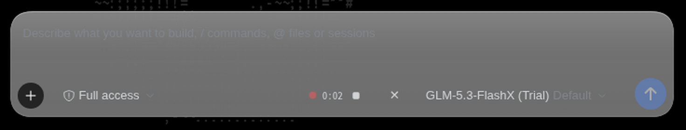
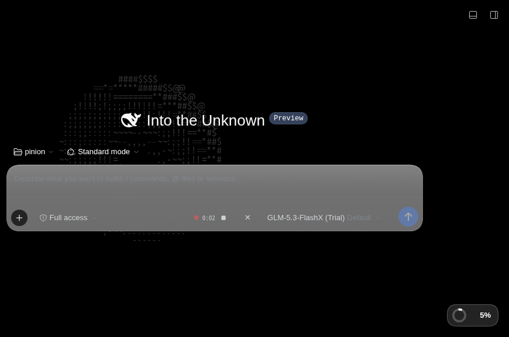

<div align="center">


# Local Wispr

**Standalone local voice input for the [DeepSeek Harness](https://github.com/deepseek-ai/deepseek-harness) composer.**

Click the microphone → speak → the transcript lands in your draft — transcribed by a
Whisper model running **on your own machine**. No cloud, no browser speech API,
no experimental voice stack, no model downloads from the plugin.

[](LICENSE)
[](https://github.com/deepseek-ai/deepseek-harness)
[](https://github.com/SYSTRAN/faster-whisper)

*한국어 | [English](#english)*



</div>

---

# 한국어

DeepSeek Harness 웹 GUI의 컴포저에 **음성 입력 버튼**을 추가하는 플러그인입니다.
하네스에 이미 존재하는 실험적 음성 입력 스택(`dsh-experimental-*speech*`, `ui-voice-input`)을
전혀 사용하지 않고, 마이크 버튼부터 녹음, 전사, 작성란 삽입까지 이 패키지 하나가 전부 처리합니다.

## 동작 방식

1. 컴포저 도구 행의 **마이크 버튼** 클릭 → 브라우저 마이크로 즉시 녹음 시작
   (빨간 펄스 점 + 타이머, 240초 자동 정지, `Escape`로 취소)
2. **정지(■) 클릭** → 녹음 blob을 같은 오리진의 호스트 라우트로 전송
3. 호스트 절반이 로컬 Whisper 게이트웨이로 전사를 위임
4. 전사 텍스트가 **녹음 시작 시점의 캐럿 위치**에 삽입됩니다
   (그 사이 초안이 변했으면 현재 캐럿에 삽입, 거부되면 조용히 포기 — **자동 전송은 절대 없음**)

전체 화면:



## 아키텍처

```
브라우저 (Harness Web UI)
│  MediaRecorder 녹음 (webm/ogg/mp4)
▼
POST /local-wispr/transcribe          ← dsh 웹서버의 same-origin 라우트
│  (호스트 절반이 trust-fence 검증 후 프록시)
▼
Whisper 게이트웨이 (예: pi-voice-board, 127.0.0.1:8813)
│  POST /api/transcribe?lang=ko
▼  faster-whisper large-v3-turbo (int8, CPU)
{ text, seconds, elapsed }  →  InputActions.insertText() → 작성란
```

- **호스트 절반** (`index.js`): dsh 웹서버에 `/local-wispr/transcribe`, `/local-wispr/health`
  두 라우트를 등록하고 게이트웨이로 프록시합니다. 브라우저는 게이트웨이(8813)에 직접 접속하지
  않으므로 CORS 문제가 없고, 게이트웨이는 루프백에만 바인딩된 채로 두어도 됩니다.
- **클라이언트 절반** (`client.js`): `conversation.input.right` 슬롯에 마이크 버튼을 렌더링하는
  React 컴포넌트. 녹음 상태 기계(idle → recording → transcribing → idle/error), 리비전 가드가
  걸린 초안 삽입, 권한 거부·무음·타임아웃 처리를 포함합니다.

## 요구 사항

| 필요한 것 | 비고 |
|---|---|
| DeepSeek Harness 0.2.x | 웹 프로필 |
| 로컬 Whisper HTTP 게이트웨이 | `POST /api/transcribe?lang=` (오디오 원본 → `{text, duration, elapsed}`), `GET /health`. 예: [pi-voice-board](docs/gateway.md) 스타일의 faster-whisper 서버 |
| 마이크 허용 가능한 오리진 | 브라우저 정책상 **HTTPS 또는 localhost** 필요 — `http://127.0.0.1:3080`은 OK, 일반 http IP 주소는 차단. 원격 접속은 테일스케일 serve 등으로 HTTPS를 여세요 |

## 설치

```bash
git clone https://github.com/pinion05/dsh-local-wispr.git
```

그 뒤 DeepSeek Harness에서 **Plugins → Install bundle**에 클론 디렉터리 경로를 넣거나,
CLI를 쓰는 경우:

```bash
dsh plugin --profile web add <클론-경로>
```

설치되면 행 하나(`local-wispr`)가 삽입되고 컴포저에 마이크 버튼이 나타납니다.

## 설정 (선택)

프로필 패치에서 이 행의 `config`를 고칩니다:

```yaml
- insert:
    - id: local-wispr
      name: '@local/dsh-local-wispr'
      config:
        endpoint: http://127.0.0.1:8813   # Whisper 게이트웨이 기준 URL
        lang: ko                          # 전사 언어 힌트 ("auto" 가능)
        timeoutMs: 240000                 # 전사 한 건 타임아웃
        maxBodyBytes: 31457280            # 녹음 본문 상한 (30MB)
```

## 문제 해결

| 증상 | 원인 · 해결 |
|---|---|
| 빨간 **`! 다시 시도`** — "마이크는 HTTPS(또는 localhost)에서만…" | 보안 컨텍스트가 아닌 오리진(일반 http + IP). `127.0.0.1:3080`으로 접속하거나 HTTPS를 여세요 |
| "Whisper gateway unreachable" | 게이트웨이가 죽어 있음 — 예: `systemctl --user start pi-voice-board` |
| 전사가 오래 걸림 | CPU 추론은 RTF≈1 (30초 녹음 → ~30초+). GPU 게이트웨이로 바꾸면 빨라집니다 |

---

# English

Adds a **voice input button** to the DeepSeek Harness web composer. It uses none of the
harness's experimental voice packages (`dsh-experimental-*speech*`, `ui-voice-input`) —
this single package owns the whole path: mic button → recording → transcription → draft
insertion.

## How it works

1. Click the **microphone** in the composer tool row → recording starts immediately
   (pulsing red dot + timer, auto-stop at 240 s, `Escape` to cancel).
2. Click **stop (■)** → the recording blob is POSTed to a same-origin host route.
3. The host half forwards it to a local Whisper gateway.
4. The transcript is inserted into the draft **at the caret captured when recording
   started** (falls back to the current caret if the draft changed; gives up silently
   if refused — **it never submits anything for you**).

## Architecture

```
Browser (Harness Web UI)
│  MediaRecorder capture (webm/ogg/mp4)
▼
POST /local-wispr/transcribe          ← same-origin route on the dsh web server
│  (host half verifies the trust fence, then proxies)
▼
Local Whisper gateway (e.g. pi-voice-board, 127.0.0.1:8813)
│  POST /api/transcribe?lang=ko
▼  faster-whisper large-v3-turbo (int8, CPU)
{ text, seconds, elapsed }  →  InputActions.insertText() → draft
```

- **Host half** (`index.js`): registers `/local-wispr/transcribe` and `/local-wispr/health`
  on the dsh web server and proxies to the gateway. The browser never touches the gateway
  directly, so no CORS is needed and the gateway can stay loopback-only.
- **Client half** (`client.js`): a React component rendering the mic button into the
  `conversation.input.right` slot, with a recording state machine (idle → recording →
  transcribing → idle/error), revision-guarded draft insertion, and handling for denied
  permission, silence, and timeouts.

## Requirements

| Need | Notes |
|---|---|
| DeepSeek Harness 0.2.x | web profile |
| Local Whisper HTTP gateway | `POST /api/transcribe?lang=` (raw audio → `{text, duration, elapsed}`) and `GET /health` — e.g. a [pi-voice-board](docs/gateway.md)-style faster-whisper server |
| Mic-capable origin | Browser policy requires **HTTPS or localhost** — `http://127.0.0.1:3080` works; plain http over an IP is blocked. For remote access, expose HTTPS (e.g. `tailscale serve`) |

## Install

```bash
git clone https://github.com/pinion05/dsh-local-wispr.git
```

Then in DeepSeek Harness: **Plugins → Install bundle**, pointing at the cloned directory
(or `dsh plugin --profile web add <path>` from the CLI). One row (`local-wispr`) is
inserted and the mic button appears in the composer.

## Configuration (optional)

Edit the row's `config` in your profile patch:

```yaml
- insert:
    - id: local-wispr
      name: '@local/dsh-local-wispr'
      config:
        endpoint: http://127.0.0.1:8813   # Whisper gateway base URL
        lang: ko                          # transcription language hint ("auto" allowed)
        timeoutMs: 240000                 # per-request transcription deadline
        maxBodyBytes: 31457280            # max recording body size (30 MB)
```

## Troubleshooting

| Symptom | Cause · fix |
|---|---|
| Red **`! retry`** — "Microphone requires HTTPS (or localhost)…" | Insecure origin (plain http + IP). Open `127.0.0.1:3080` or serve HTTPS |
| "Whisper gateway unreachable" | Gateway is down — e.g. `systemctl --user start pi-voice-board` |
| Transcription feels slow | CPU inference runs at RTF≈1 (30 s recording → ~30 s+). A GPU gateway makes it fast |

---

<div align="center">

Built for [pinion05](https://github.com/pinion05)'s own ThinkPad + iPhone tailnet setup.
Icon and screenshots are original works. License: [MIT](LICENSE).

</div>
